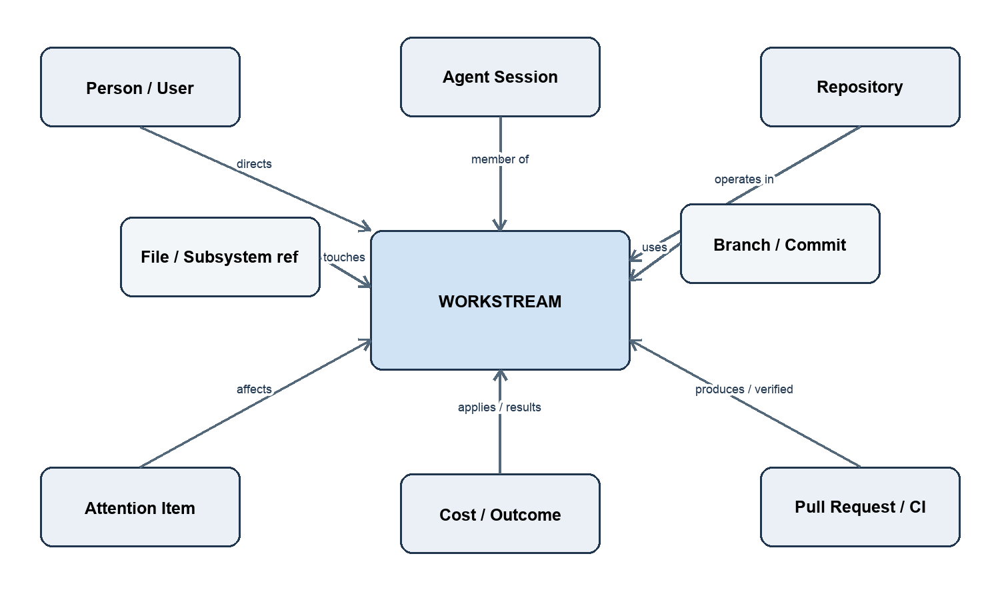
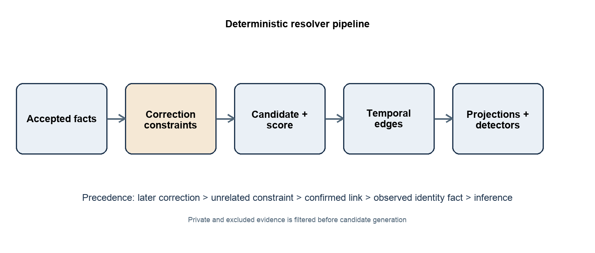

# Abisso — Live Engineering Work Graph Specification

> **Source:** `Abisso_Live_Engineering_Work_Graph_Specification_v0.1.docx`  
> **Version:** 0.1  
> **Role:** V0 implementation authority for Work Graph entities, relationships, correlation, corrections and projections  
> **Repository note:** This is an agent-readable Markdown mirror of the authoritative DOCX. It must remain consistent with documents 1–4.

---

Document 5 of the Abisso product and engineering specification set

Status Implementation specification for V0

Product category Engineering Agent Control Plane

Core model Live Engineering Work Graph

Initial wedge Needs Attention

Date 15 September 2026

This specification fixes the bounded V0 domain model and deterministic correlation behavior that convert canonical agent telemetry, GitHub and GitHub Actions facts, and durable user corrections into current and historical Workstream views. It keeps Workstream as the user-facing unit while treating graph concepts as internal implementation language.

# Decision summary

**DECIDED FOR V0.** Workstream is the central unit of intended engineering work and may exist before a branch, commit, pull request, or issue exists.

**DECIDED FOR V0.** PostgreSQL stores typed entities, temporal relationships, evidence references, durable corrections, and projections. V0 does not use a graph database.

**DECIDED FOR V0.** Observed source facts remain immutable. Inference is separately versioned, explainable, replayable, and subordinate to user-confirmed and user-rejected relationships.

**DECIDED FOR V0.** Many sessions may contribute to one Workstream and one Workstream may produce multiple pull requests. Correlation never forces one-to-one mappings.

**DECIDED FOR V0.** Private-session events never enter the shared outbound queue. A collection gap may be visible, but the graph must not infer the hidden session, provider, repository, activity, or outcome.

# Contents

1 Purpose scope authority and document relationships

2 Goals and non goals

3 Core design principles

4 Terminology

5 Workstream central model

6 V0 entity model

7 Stable identity rules

8 Relationship taxonomy and cardinality

9 Temporal relationships

10 Provenance confidence and evidence

11 Workstream creation and correlation

12 Repository worktree branch commit and pull request correlation

13 CI file and subsystem attachment

14 Outcomes costs attention and interventions

15 User corrections precedence merge and split

16 Lifecycle and outcome models

17 Multi session multi pull request and session movement behavior

18 Privacy gaps unknowns conflicts and contradictions

19 Required projections and query patterns

20 Relational implementation model

21 Invariants

22 Replay audit and scoring

23 Correlation scenarios

24 Prohibited inferences

25 Acceptance criteria and contract tests

26 Golden graph fixtures

27 Telemetry mapping

28 GitHub and GitHub Actions mapping

29 Quality metrics

30 Deferred capabilities

31 Open questions

32 Change log

# 1 Purpose scope authority and document relationships

This document is the implementation authority for the V0 Live Engineering Work Graph: its entities, identities, relationships, temporal behavior, deterministic resolvers, corrections, projections, and read contracts. It enables the Live, Needs Attention, and Workstream Detail experiences, plus outcome reconciliation and cost attachment.

| **Document** | **Authority retained** | **Relationship to this specification** |
|----|----|----|
| 1 Product Thesis and Founding Charter v1.0 FROZEN | Product thesis, category, strategic principles and boundaries | This document implements the Work Graph without altering strategy. |
| 2 V0 PRD v0.2 FROZEN | V0 scope, user behavior, detector release gates and acceptance behavior | This document supplies the domain and read model required by those experiences. |
| 3 System Design and Technical Architecture v0.2 FROZEN | System boundaries, PostgreSQL-first architecture, macOS-first collector, GitHub App and privacy controls | This document elaborates only the relational Work Graph seam. |
| 4 Canonical Agent Event and Telemetry Specification v0.2 FROZEN | Canonical event contract, fact classes, privacy transforms, availability semantics and replay inputs | This document consumes accepted canonical facts without modifying their meaning. |

Where documents conflict, documents 1 through 4 retain authority over their assigned concern. This specification must be amended rather than silently overriding them. Security mechanisms not needed to define graph behavior remain for document 6.

# 2 Goals and non goals

## Goals

- Represent the minimum V0 entities and relationships needed for Live, Needs Attention, Workstream Detail, outcomes, and cost.

- Correlate incomplete evidence before a branch or pull request exists.

- Preserve temporal history, source provenance, confidence, resolver version, and user correction precedence.

- Make every inferred link explainable through bounded evidence references and deterministic scoring.

- Support replay and projection rebuilds without rewriting accepted source facts.

- Represent uncertainty, staleness, exclusions, and contradictions explicitly.

## Explicit non goals

- A universal software-development ontology; issue trackers, deployments, organizations, teams, services, environments, and dependency graphs are not first-class V0 nodes.

- Customer-facing graph vocabulary or arbitrary graph exploration. Users work with Workstreams and attention items.

- Opaque ML entity resolution, cross-workspace identity matching, or behavioral surveillance.

- Raw source, diffs, prompts, responses, transcripts, command output bodies, secrets, keystrokes, screenshots, clipboard contents, personal messages, or idle-time telemetry.

- Replacing GitHub as authority for pull request, review, commit, or GitHub Actions facts.

# 3 Core design principles

| **Principle** | **V0 rule** |
|----|----|
| Workstream centric | All product projections converge on intended work, not on an agent, person, branch, or pull request. |
| Temporal | Edges describe intervals. Ending or superseding a relationship never erases its prior validity. |
| Provenance aware | Every fact or relationship points to its source class and evidence references. |
| Confidence aware | Only inferred edges carry a resolver score and confidence band; observed and corrected edges do not masquerade as probabilistic. |
| Observed and inferred separation | Immutable source facts and replaceable resolver outputs occupy separate records. |
| User correctable | Corrections add durable precedence and audit records; they do not mutate source facts. |
| Privacy safe | Only fields allowed by docs 3 and 4 enter graph storage. Path-derived refs are workspace-keyed. |
| Replayable | Given the same accepted facts, correction log, configuration, and resolver version, resolution is deterministic. |

# 4 Terminology

| **Term** | **Definition** |
|----|----|
| Entity | A typed, workspace-scoped record with a stable identifier. |
| Relationship | A directed typed assertion between two entities, optionally bounded by time. |
| Fact | An accepted canonical, GitHub, GitHub Actions, or user-action assertion. |
| Evidence reference | A pointer to an immutable accepted fact or durable correction; never an embedded raw body. |
| Workstream | One evolving unit of intended engineering work. |
| Resolver | Versioned deterministic logic that proposes inferred relationships. |
| Projection | A rebuildable read model optimized for a V0 experience. |
| Current edge | An effective relationship whose valid_to is null and which is not suppressed by precedence. |
| Historical edge | An ended or superseded relationship retained for audit and timeline reads. |
| Correction | A durable user assertion that confirms, rejects, moves, merges, splits, renames, or reconciles. |
| Availability | available, unavailable, unknown, stale, excluded, private, or not_collected as defined by document 4. |

# 5 Workstream as the central V0 unit

A Workstream represents one evolving unit of intended engineering work. It is neither a ticket nor a branch. It can begin from a session or explicit user action, accumulate sessions and artifacts, change branches, produce several pull requests, wait for review, fail CI, complete, or be abandoned.

A Workstream has a stable internal ID, a mutable user-facing task label, lifecycle state, outcome state, temporal membership edges, and derived rollups. Labels are not identities. Repository and branch changes do not by themselves create or destroy a Workstream.

| **Property** | **Rule** |
|----|----|
| Creation | Create provisionally from the first eligible non-private session or explicitly from a user action. |
| Identity | Workspace-scoped UUID; never derived from a label, branch, path, or PR number. |
| Membership | Sessions and artifacts attach through temporal edges; many-to-many is allowed where specified. |
| Presentation | Use “Workstream” in the product. Do not expose node/edge jargon. |
| State | Operational state answering what needs attention now. |
| Outcome | Result answering what happened to intended work; independent from operational state. |
| History | Merge and split preserve source facts and correction lineage. |

Internal conceptual view: User -\> Session -\> Workstream -\> Repository or Branch -\> Commit or Pull Request -\> Review or CI -\> Outcome. Attention items, interventions, and costs attach at the narrowest supported scope and roll up to the Workstream.

<figure>

<figcaption>
Figure 1 V0 Workstream centered entity and relationship view
</figcaption>
</figure>

# 6 V0 entity model

| **Entity** | **Meaning** | **Why V0 needs it** | **Type key** |
|----|----|----|----|
| Person or User | Workspace member controlling sessions and making corrections | Live ownership and intervention attribution | user |
| Machine | Enrolled collector host | Collector provenance and session origin | machine |
| Agent Session | One provider session with canonical lifecycle | Primary pre-branch work evidence | session |
| Workstream | Evolving unit of intended work | Central product object | workstream |
| Repository | GitHub repository or locally correlated repository identity | Artifact and work scope | repository |
| Worktree | Privacy-safe local checkout identity | Distinguish concurrent checkouts | worktree |
| Branch | Repository-scoped branch identity | Strong correlation and PR head matching | branch |
| Commit | Repository-scoped immutable Git object | Durable work artifact | commit |
| File or Subsystem Reference | Workspace-keyed opaque file_ref and optional derived subsystem_ref | Overlap or conflict evidence | file_ref/subsystem_ref |
| Pull Request | GitHub repository plus PR number | Review and acceptance carrier | pull_request |
| Review | GitHub review identity | Review status and congestion | review |
| CI Run or Check | GitHub Actions run and check identities | CI state and repeated failure | ci_run/ci_check |
| Attention Item | Detector finding instance | Needs Attention | attention_item |
| Intervention or User Action | Durable product action | Correction and response history | intervention |
| Cost Record or Rollup | Observed usage, observed money, or derived priced estimate | Cost visibility | cost_record/cost_rollup |
| Outcome | Current reconciled result plus history | Accepted, Rejected, Reverted, Abandoned, Open, Unknown | outcome |

**DEFERRED.** Tickets, deployments, releases, organizations, teams, services, environments, dependency nodes, semantic symbols, messages, prompts, commands, and arbitrary external artifacts are not first-class V0 entities.

# 7 Stable identity rules

| **Node** | **Stable identity** | **Important rule** |
|----|----|----|
| User | workspace_id + auth_subject; exactly one workspace per user in V0 | Changing display name does not change ID. |
| Machine | workspace_id + server-issued enrollment UUID | Re-enrollment creates a new Machine unless continuity is cryptographically established. |
| Agent Session | workspace_id + provider + provider_session_ref; collector fallback UUID only under doc 4 rules | Never infer identity across private gaps. |
| Workstream | workspace_id + generated UUID | Merge/split use lineage; labels never determine identity. |
| Repository | workspace_id + GitHub repository node ID when connected; otherwise workspace-keyed local repo_ref | A later GitHub match aliases local identity; source IDs remain. |
| Worktree | workspace_id + workspace-keyed worktree_ref | No cross-workspace equality. |
| Branch | repository_id + normalized full ref | Branch deletion does not delete identity. |
| Commit | repository_id + full object ID | Abbreviated SHAs are evidence only until resolved. |
| File ref | workspace_id + keyed derivation output + derivation version | No raw path and no cross-workspace comparison. |
| Subsystem ref | workspace_id + resolver-owned stable opaque ID/version | Derived from permitted keyed refs, never raw contents. |
| Pull Request | repository_id + GitHub PR node ID; number is a display key | Repository transfer retains GitHub node provenance. |
| Review | pull_request_id + GitHub review node ID | Dismissal changes state, not identity. |
| CI Run | repository_id + GitHub Actions run ID | Rerun is a distinct run. |
| CI Check | ci_run_id + GitHub check-run ID | Name alone never identifies a check. |
| Attention Item | workspace_id + detector_type + finding instance UUID | Dedup key is separate from stable ID. |
| Intervention | workspace_id + append-only user-action UUID | Idempotency key prevents duplicate actions. |
| Cost Record | workspace_id + source record ID/event ID | Units and money are separate records or dimensions. |
| Cost Rollup | workspace_id + scope + bucket + pricing_version | Rebuildable, not authoritative. |
| Outcome | workstream_id + outcome record UUID | Only one effective current outcome, with historical versions. |

# 8 Relationship taxonomy and cardinality

| **Edge** | **Direction** | **Cardinality** | **Typical provenance** |
|----|----|----|----|
| DIRECTS | User -\> Session | 1:M current; session has one directing user in V0 | Observed |
| ORIGINATES_ON | Session -\> Machine | M:1 | Observed |
| MEMBER_OF | Session -\> Workstream | M:N historical; at most one effective primary Workstream per session interval | Inferred or corrected |
| OPERATES_IN | Session -\> Repository | M:N over time | Observed/inferred |
| USES_WORKTREE | Session -\> Worktree | M:N over time | Observed |
| ON_BRANCH | Session -\> Branch | M:N over time; one current branch per repo where evidence is available | Observed/inferred |
| TOUCHES | Session -\> File ref | M:N | Observed canonical fact |
| GROUPED_IN | File ref -\> Subsystem ref | M:N versioned | Derived |
| CONTAINS | Repository -\> Branch/Commit/PR | 1:M | Observed GitHub/Git |
| PRODUCED | Workstream -\> Commit/PR | M:N | Inferred/confirmed |
| HEADS | Branch -\> PR | M:N historical | Observed GitHub |
| INCLUDES | PR -\> Commit | M:N | Observed GitHub |
| HAS_REVIEW | PR -\> Review | 1:M | Observed GitHub |
| VERIFIED_BY | PR/Commit -\> CI Run/Check | M:N | Observed GitHub Actions |
| AFFECTS | Attention Item -\> Workstream/Session/PR/CI | M:N | Derived detector output |
| RESPONDS_TO | Intervention -\> Attention Item | M:N | User asserted |
| APPLIES_TO | Cost Record -\> Session/Workstream/PR | M:N with allocation metadata | Observed/derived |
| RESULTS_IN | Workstream -\> Outcome | 1:M historical; one effective current | Observed/derived/corrected |
| UNRELATED_TO | Session/Workstream pair | M:N symmetric semantic relation stored canonically | User rejected |

Many-to-many edges are intentional. A pull request may contain commits from more than one Workstream and a Workstream may span more than one pull request. The UI should mark ambiguous or shared attachment rather than force ownership.

# 9 Temporal relationships

Every relationship record contains valid_from, valid_to, recorded_at, superseded_by_relationship_id, and effective status. valid_from/valid_to describe when the assertion applies in domain time; recorded_at describes when Abisso learned it. valid_to is exclusive.

| **Operation** | **Required behavior** |
|----|----|
| Start | Insert a relationship interval. Do not overwrite another interval. |
| End | Set valid_to after evidence of cessation or a correction; retain evidence. |
| Supersede | Insert the replacement and link the old relationship through superseded_by_relationship_id. |
| Late fact | Insert using source event time where trusted; recompute affected bounded window. |
| Correction | End or suppress lower-precedence effective edges and add corrected edge or negative constraint. |
| Deletion upstream | Mark source availability or staleness; do not erase graph history. |
| Current read | Select non-suppressed edge effective at as_of with highest precedence. |
| Historical read | Return all intervals and correction/supersession lineage. |

Intervals for the same semantic edge may touch but must not overlap after compaction. Resolver recomputation may replace inferred intervals, never observed source facts or correction records.

# 10 Provenance confidence and evidence

## Provenance classes

| **Class** | **Meaning** | **Precedence** |
|----|----|----|
| observed | Direct canonical or GitHub/GitHub Actions fact | Authoritative for the specific source claim, but not automatically for intended-work membership. |
| inferred | Resolver conclusion from accepted evidence | Lowest relationship precedence and replaceable on replay. |
| user_confirmed | User affirms a positive relationship or outcome | Sticky until a later user correction. |
| user_rejected or unrelated | User denies a candidate relationship | Blocks the same or materially equivalent evidence from re-linking. |
| user_asserted | Browser/product action creates a fact such as rename or manual abandonment | Durable and audited. |

## Confidence model

Only inferred relationships use confidence. Store integer score, band, evidence feature vector, resolver version, and explanation code list. Bands are High 80-100, Medium 50-79, Weak 1-49, and None 0. High may auto-link unless a correction blocks it. Medium creates a candidate or provisional link according to edge type. Weak evidence alone never merges Workstreams.

## Evidence references and resolver versions

- Each inferred edge references at least one immutable evidence row and the exact resolver_version.

- References identify source kind, source record ID, event time, received time, and evidence role; they do not duplicate prohibited payloads.

- Resolver configuration and weight set are content-addressed and deployed with a semantic version.

- An inference explanation must be reproducible from evidence refs plus resolver version.

- User corrections reference the relationships or entities affected and a correction_reason code; free text is optional and must follow privacy policy.

# 11 Workstream creation and session correlation

## Creation before branch or pull request

1.  Accept an eligible canonical session-start or first meaningful session activity event.

2.  Resolve workspace, user, machine, and stable session identity.

3.  If no sticky confirmed membership and no eligible high-confidence Workstream match exists, create a provisional Workstream with generated UUID and safe task label.

4.  Attach the session with an inferred MEMBER_OF edge whose evidence may consist only of session origin, time, provider-safe task label, and repository availability.

5.  Allow later branch, commit, pull request, user confirmation, or rename evidence to strengthen or correct the Workstream without changing its ID.

A session with repository unavailable or unknown still creates or joins a Workstream when other allowed evidence supports it. Missing repository evidence is never treated as evidence of a new repository or a hidden one.

## Session-to-Workstream pipeline

6.  Normalize accepted facts into entity candidates and evidence features.

7.  Apply workspace isolation and private/excluded/availability filters.

8.  Apply correction constraints: sticky memberships, unrelated pairs, prior split boundaries, and explicit moves.

9.  Generate bounded candidates from same user, active time window, repository identity, branch, PR head, commit, and keyed file overlap.

10. Rank evidence by strength and compute deterministic score.

11. Choose action: auto-link high confidence; provisional candidate for medium; no link for weak-only evidence.

12. Write temporal inferred edges and evidence refs atomically.

13. Refresh affected Workstream projections and detector inputs.

14. Emit an explanation suitable for Workstream Detail.

<figure>

<figcaption>
Figure 2 Resolver flow and correction precedence
</figcaption>
</figure>

# 12 Repository worktree branch commit and pull request correlation

| **Evidence** | **Rule** |
|----|----|
| Same GitHub repository node ID | Exact repository match; strong but insufficient alone to merge tasks. |
| Local repo_ref later matched to GitHub | Create identity alias and supersede inferred local-only repository edge; retain both source facts. |
| Same worktree_ref | Strong evidence of shared execution context, not intended-work identity by itself. |
| Same repository and exact branch | Strong session-to-Workstream evidence unless blocked by corrections or evidence shows unrelated sequential work. |
| Branch switch | End ON_BRANCH at observed switch time and open a new interval. Do not automatically move Workstream. |
| Commit authored/created during session interval | Strong when repository and branch ancestry agree; medium when only temporal/repository match. |
| PR head matches branch | Observed HEADS plus strong PRODUCED candidate for the Workstream active on that branch. |
| PR includes commit already linked to Workstream | Strong PRODUCED evidence; multiple Workstreams may attach. |
| Same PR number in different repositories | Unrelated identities. |
| Force push or rebase | Update observed PR/branch membership history; do not delete prior commit edges. |

A branch may be reused. Temporal proximity and current membership are required; branch name equality separated by a material inactivity boundary must not silently merge historical Workstreams.

# 13 CI file and subsystem attachment

## GitHub Actions and CI

- Attach a CI run to the exact repository and head commit from GitHub Actions.

- Attach to a pull request when GitHub reports the association; otherwise infer only through an exact head commit or checked SHA.

- Attach to one or more Workstreams through linked PRs/commits. Shared CI remains shared; do not duplicate the observed run.

- Reruns are distinct CI Run nodes related by a retry lineage attribute or edge metadata. Repeated CI Failure uses check identity, failure signature where permitted, and attempt sequence.

- Unknown, skipped, cancelled, neutral, and timed-out conclusions remain distinct.

## File and subsystem overlap

File overlap uses only workspace-scoped keyed file_ref values admitted by document 4. Equality is valid only within one workspace and derivation version. No raw path, filename, directory, source, or diff is required.

| **Signal** | **Treatment** |
|----|----|
| Exact keyed file_ref overlap in same repo and close interval | Medium overlap evidence; may trigger overlap detector, never sufficient alone to merge. |
| High proportion of overlapping refs | Increase overlap evidence rank, bounded by repository and time. |
| Subsystem_ref overlap only | Weak to medium, depending on subsystem resolver quality. |
| Different derivation versions | Compare only through authorized re-key mapping; otherwise unknown. |
| Excluded or private files | No file node or negative inference. |
| Same file in separate workspaces | Not comparable by design. |

# 14 Outcomes costs attention and interventions

## Outcome attachment and reconciliation

| **Source situation** | **Outcome rule** |
|----|----|
| At least one associated PR open; no terminal correction | Open |
| Associated PR merged and not later reverted; intended work accepted | Accepted |
| PR closed without merge and user/GitHub context supports rejection | Rejected; do not equate every closed PR with rejection when ambiguity exists |
| Accepted change later reverted by identified revert commit/PR or user correction | Reverted, with reference to prior Accepted outcome |
| User abandons work before acceptance | Abandoned |
| Evidence incomplete or conflicting | Unknown |

When a Workstream has multiple PRs, outcome is reconciled across them. Accepted requires the intended Workstream to be accepted, not merely one incidental PR. If some PRs merge and others remain open, the default outcome is Open unless a user confirms completion. State may be Completed while outcome remains Unknown only when product behavior explicitly permits an unresolved reconciliation; the projection must expose the discrepancy.

## Cost attachment

- Store physical usage and money separately. Provider-reported money is the only observed cost. A derived monetary estimate carries pricing_version, currency, and estimation provenance.

- Attach exact session usage to the session first; roll up through effective session membership intervals.

- When a session is shared across Workstreams, allocate only with explicit deterministic allocation evidence; otherwise show unallocated cost and avoid false precision.

- Never convert missing, unavailable, excluded, or unsupported cost to zero.

- Late cost records recompute affected rollups without mutating the source record.

## Attention and intervention attachment

- A detector creates an Attention Item with detector version, evidence refs, opened_at, status, severity, and target scope.

- Waiting for Human and Repeated Failure normally target a session and affect its Workstream. Overlapping/Conflicting Work may affect two or more Workstreams and sessions.

- Follow-on V0 detectors remain No Progress/Cost Escalation, Repeated CI Failure, and Review Congestion. Release gates remain owned by the PRD.

- Interventions attach to the item acted on and to the affected Workstream where known. Dismissal resolves presentation, not the underlying evidence.

# 15 User corrections precedence merge and split

| **Action** | **Graph effect** |
|----|----|
| Confirm | Create sticky user_confirmed positive edge; suppress competing inferred memberships over the confirmed interval. |
| Move session | End prior effective MEMBER_OF interval and create confirmed membership at correction effective time; retain earlier history unless user selects whole-history move. |
| Merge Workstreams | Create merge correction and survivor lineage; consolidate projections while retaining both IDs as historical aliases. |
| Split Workstream | Create new Workstream ID, partition selected memberships/artifacts by explicit criteria, and add split lineage. |
| Mark unrelated | Create canonical negative constraint between specified entities and evidence scope. |
| Rename task label | Append label revision; identity and source labels remain unchanged. |
| Correct outcome | Append user-confirmed outcome version and suppress lower-precedence derived outcome. |

## Sticky confirmation and negative-link precedence

Precedence from highest to lowest is later explicit user correction, existing user-rejected constraint, existing user-confirmed link, observed source identity facts, and inferred link. Observed facts cannot be declared false by a membership correction; instead the correction changes the intended-work interpretation.

An unrelated constraint records the pair, direction semantics, time/evidence scope, fingerprint of evidence features, and correction version. The resolver must not immediately recreate the rejected link from the same or a subset of evidence. Materially new strong evidence may create a candidate for user review, not an automatic merge.

## Merge semantics

- Default survivor is the older user-confirmed Workstream; otherwise the older Workstream. A user may choose the survivor.

- Survivor ID remains current. Retired Workstream IDs remain resolvable as aliases with merged_into lineage.

- Source entities, observed edges, timestamps, evidence, corrections, attention items, interventions, and outcome history remain intact.

- Effective memberships move through new confirmed or merge-derived edges; old intervals end at merge effective time.

- Labels use the user-selected label or survivor label; prior labels remain in history.

- Conflicting outcomes reconcile to Unknown until resolved; costs are recomputed, never summed from already aggregated rollups.

## Split semantics

- The original Workstream remains for the partition the user designates; each additional partition receives a new UUID.

- The split specifies sessions, time intervals, PRs, commits, or other allowed artifacts to move.

- Observed facts stay attached to their source entities. Only intended-work relationships and projections change.

- Ambiguous shared artifacts may remain many-to-many and are visibly marked shared or unresolved.

- A split installs negative constraints across the resulting partitions for the evidence scope that caused the accidental merge.

- Attention, cost, and outcome projections recompute from atomic records. Historical views show the pre-split graph and correction event.

# 16 Lifecycle and outcome models

## Workstream lifecycle state

| **State** | **Deterministic V0 rule** |
|----|----|
| Active | Recent productive or execution activity; no higher-priority blocking state. |
| Needs Attention | At least one open actionable Attention Item not represented by a more specific surfaced state. |
| Waiting | Waiting for Human detector is active or explicit supported waiting fact exists. |
| In Review | Associated PR is open and review is requested or pending; no active CI failure taking precedence. |
| CI Failing | Associated current PR/head has required failing CI. |
| Completed | Workstream execution is complete by accepted reconciliation or user confirmation. |
| Abandoned | User explicitly abandoned or reconciled abandonment is effective. |
| Unknown | Insufficient, stale, unavailable, or contradictory evidence prevents a reliable current state. |

Display precedence for simultaneous conditions is CI Failing, Waiting, Needs Attention, In Review, Active, Completed, Abandoned, Unknown, subject to product-specific presentation. Underlying conditions remain visible; precedence does not delete them. State describes current operating condition. Outcome describes result. They must be stored and reasoned about separately.

## Outcome state

| **Outcome** | **Meaning** |
|----|----|
| Accepted | The intended work was accepted into the authoritative code line or user-confirmed equivalent. |
| Rejected | The intended work was explicitly declined or closed without acceptance with sufficient evidence. |
| Reverted | Previously accepted work was subsequently undone. |
| Abandoned | The intended work was stopped without acceptance. |
| Open | The result remains in progress or undecided. |
| Unknown | Available evidence cannot determine the result. |

# 17 Multi session multi pull request and session movement behavior

- Multiple sessions join one Workstream when high-confidence evidence aligns or a user confirms it. Each session retains its own provider, machine, timing, costs, and attention history.

- A Workstream may produce multiple PRs sequentially or concurrently. PR state rolls up without assuming the first merge completes all intended work.

- A session changing repository or branch ends the prior contextual edge and begins another. A repository change is a candidate boundary, not automatic proof of unrelated work.

- If one session appears to span unrelated work, create temporal membership segments only when there is a strong boundary such as an explicit user move, repo/branch discontinuity plus inactivity, or artifact divergence. Otherwise keep one membership and surface uncertainty.

- A single session may have multiple historical Workstream intervals. Concurrent primary memberships for the same instant require explicit shared-work confirmation and must be visible as ambiguous/shared.

# 18 Privacy gaps unknowns conflicts and contradictions

## Private and excluded evidence gaps

No private-session event enters the shared outbound queue. Shared history may show that collection stopped and resumed, and therefore the existence and duration of an observation gap. The graph must not create or infer a private session, provider, repository, branch, file, activity, cost, Workstream, link, or outcome for that interval. Excluded evidence is treated similarly within its excluded scope.

## Stale unavailable and unknown relationships

| **Condition** | **Behavior** |
|----|----|
| Stale | Keep last known edge with stale_since metadata; exclude from automatic high-confidence actions after edge-specific TTL. |
| Unavailable | Record source cannot provide the property; do not retry as if transient and do not infer a negative. |
| Unknown | Resolver cannot decide; keep candidates separate and expose uncertainty where relevant. |
| Not collected | No graph conclusion may depend on the absent field. |
| Source disconnected | Retain history, mark freshness, and stop asserting currentness after TTL. |
| Entity deleted upstream | Tombstone observed status; preserve identity and history. |

## Conflict and contradiction handling

15. Persist all accepted source facts with source and time.

16. Classify contradiction type: timing, identity, membership, state, or outcome.

17. Apply precedence without deleting lower-precedence evidence.

18. Set affected inferred relationship or projection to disputed or Unknown when no rule resolves it.

19. Create or update a resolvable Attention Item only when V0 product behavior calls for human action.

20. Record resolution as a correction or new authoritative source fact.

# 19 Required projections and query patterns

## Current-state projections

| **Projection** | **Minimum fields** |
|----|----|
| workstream_current | ID, label, user, lifecycle state, outcome, repository summary, freshness, confidence/confirmation summary, active attention count, last_activity_at |
| workstream_members_current | Current sessions, repositories, worktrees, branches, commits, PRs with relationship provenance |
| workstream_timeline | Ordered observed facts, inferred changes, corrections, interventions, attention transitions, CI, reviews, outcomes |
| live_session_current | Session state, provider, machine, Workstream, repo/branch availability, waiting/failure indicators, last activity |
| needs_attention_current | Open items ranked by severity/age, targets, evidence explanation, detector version, suggested action |
| pr_ci_current | PR review state, required checks, latest run/check result, Workstream associations |
| workstream_cost_current | Observed usage/money, derived estimates, unallocated amount, completeness/availability |
| relationship_candidates | Medium-confidence unresolved candidates and explanations |

## Required read patterns

- List active Workstreams for one workspace ordered by attention priority then recent activity.

- Fetch Workstream Detail with current members and bounded timeline in one predictable read path.

- Find sessions without effective Workstream membership.

- Find competing Workstream candidates for a session with evidence explanations.

- Traverse Workstream -\> PR -\> CI and Workstream -\> sessions -\> attention using bounded depth only.

- Resolve retired IDs through merge/split aliases.

- Read graph as of a timestamp and compare before/after a correction.

- Compute affected projection keys from an event, webhook, or correction.

- Find stale current edges and unresolved contradictions.

- Reconcile Workstream outcomes and costs from atomic attachments, not prior rollups.

# 20 V0 relational implementation model

**DECIDED FOR V0.** Use PostgreSQL entity tables, one generic temporal relationship table, evidence reference tables, correction/audit tables, and rebuildable projections. Queries use indexed joins and bounded recursion. No graph database is introduced.

| **Table group** | **Illustrative tables** | **Purpose** |
|----|----|----|
| Entities | users, machines, agent_sessions, workstreams, repositories, worktrees, branches, commits, file_refs, subsystem_refs, pull_requests, reviews, ci_runs, ci_checks, attention_items, interventions, cost_records, outcomes | Typed constraints and stable identities. |
| Relationships | graph_relationships | from_type/from_id, edge_type, to_type/to_id, valid_from, valid_to, provenance, score, confidence_band, resolver_version, status, superseded_by. |
| Evidence | relationship_evidence | relationship_id, source_kind, source_id, evidence_role, source_event_time. |
| Corrections | graph_corrections, correction_targets, negative_constraints, workstream_lineage | Durable precedence and audit. |
| Aliases | entity_aliases | Local-to-GitHub identity resolution and retired Workstream lookup. |
| Projections | workstream_current, workstream_members_current, live_session_current, needs_attention_current, pr_ci_current, workstream_cost_current | Fast current reads; always rebuildable. |
| Resolver control | resolver_releases, replay_runs, projection_checkpoints | Version and replay traceability. |

Illustrative uniqueness constraints include workspace isolation on every entity, repository plus full commit object ID, repository plus GitHub PR node ID, one open effective current outcome per Workstream, idempotent accepted source IDs, and non-overlapping effective membership intervals after precedence. Final SQL types, partitioning, and indexes remain an implementation detail so long as these contracts hold.

# 21 Invariants

21. Every graph entity belongs to exactly one workspace; a User belongs to exactly one workspace in V0.

22. No relationship crosses workspace boundaries.

23. Observed source facts are immutable after acceptance.

24. An inferred edge always has evidence references, score, explanation codes, and resolver version.

25. A user-confirmed or user-rejected relationship is never removed by replay.

26. Negative constraints prevent automatic re-creation from the same or weaker evidence.

27. At most one effective primary Workstream membership exists for a session at an instant unless explicit shared membership is user-confirmed.

28. valid_to is null or greater than valid_from; ended history remains queryable.

29. No raw prohibited content or globally comparable sensitive path identifier appears in graph storage.

30. Private or excluded gaps never create inferred hidden entities or facts.

31. Missing cost is not zero and estimated cost is not observed cost.

32. State and outcome are separate fields with separate reconciliation rules.

33. Merge and split preserve entity IDs, source evidence, correction history, and lineage.

34. Every projection row is derivable from accepted facts, durable corrections, and resolver/config versions.

35. All traversals used by V0 product reads are workspace-scoped and depth-bounded.

# 22 Replay audit and deterministic scoring

## Replay and recomputation

- A resolver release defines code version, weight/config digest, supported event/schema versions, and activation time.

- Replay reads immutable accepted facts and corrections in event-time order with deterministic late-event policy.

- Recompute only inferred relationships and projections inside an affected workspace/time window.

- Write new resolver outputs alongside old versions, compare invariant and quality metrics, then atomically promote.

- Never overwrite observed facts, corrections, or user-confirmed/rejected precedence.

- If a new resolver conflicts with a sticky correction, retain the correction and record the suppressed proposal for diagnostics.

## Correction and audit history

Every correction stores actor, workspace, action type, targets, effective time, recorded time, idempotency key, optional reason code, prior effective relationship IDs, and generated relationship IDs. Undo is a new correction that supersedes the earlier correction; it is not deletion.

## Scoring framework

| **Evidence class** | **Illustrative signals** | **Default points** |
|----|----|----|
| Strong | Exact confirmed membership; exact PR head branch; exact linked commit; same repo plus exact current branch | 100 override; 55; 50; 45 |
| Medium | Same worktree; substantial keyed file overlap; close temporal continuity; same safe task label | 30; up to 25; up to 20; up to 15 |
| Weak | Same user; same provider; same repository alone; subsystem overlap alone | 5; 2; 10; up to 10 |
| Negative | User unrelated; incompatible repository with no transition; non-overlapping distant interval; prior split boundary | block; -40; -25; block |

Scores are illustrative defaults and must be fixture-tested before release. Candidate generation is bounded. Evidence features are capped so repeated weak events cannot overwhelm one strong contradiction. Auto-link threshold is 80, provisional candidate threshold is 50, and below 50 means no membership link. User-confirmed links and user-rejected constraints bypass numeric scoring through precedence.

# 23 Correlation scenarios

## One session before branch or PR

Session S1 starts with user, machine, and repository unknown. A provisional W1 is created and S1 MEMBER_OF W1 is inferred. Later repository R1 and branch B1 arrive; contextual edges open. PR1 later reports B1 as head; W1 PRODUCED PR1 becomes high confidence. W1 ID never changes.

## Two sessions contribute to one Workstream

S1 creates W1 on R1/B1. S2 begins later for the same user on R1/B1 and shares PR1-linked commits. Score exceeds 80, so S2 joins W1. Both session histories and costs remain distinct.

## Same repo and same branch

S3 starts while W1 is active on exact R1/B1. Repository plus branch is strong; temporal continuity raises score. Auto-link is allowed unless an unrelated constraint exists.

## Same repo and overlapping files but unrelated

S4 and S5 touch several equal keyed refs in R1. Branches and safe task labels differ; user marks unrelated. The negative constraint blocks merge. Overlap may still produce an Overlapping/Conflicting Work attention item.

## Session moves to another branch

S1 emits branch switch from B1 to B2. ON_BRANCH B1 ends; ON_BRANCH B2 begins. S1 remains in W1 unless additional strong evidence or user action creates a new membership interval.

## Accidental merge then split

Resolver merged S6 and S7 into W2 from shared branch and files. User splits S7 and PR3 to new W3. Graph preserves pre-split W2 history, creates lineage and negative constraints, recomputes costs/outcomes, and does not alter source facts.

## One Workstream produces multiple PRs

W4 yields PR4 for implementation and PR5 for follow-up. Both attach through exact commits/branches. W4 remains Open until intended work is reconciled, then Accepted when both required parts are merged or user confirms completion.

## Private session evidence gap

Collector reports shared activity, then a privacy-state transition and later return. No private events exist. Graph marks an observation gap and freshness uncertainty only; it does not invent a session, repo, Workstream, cost, or outcome.

## PR merged then reverted

PR6 merge establishes Accepted for W5. A later identified revert commit/PR or user correction creates a Reverted outcome superseding Accepted. Historical outcome and acceptance time remain queryable.

# 24 Prohibited inferences

- Do not infer that two sessions are the same intended task from user, provider, repository, or file overlap alone.

- Do not infer a private session or its provider/repository/activity from a collection gap.

- Do not infer acceptance merely because any associated PR merged.

- Do not infer rejection from every PR close without merge.

- Do not infer zero cost from absent usage or money fields.

- Do not infer two files match across workspaces from keyed refs.

- Do not infer current branch from the last known branch after freshness expires.

- Do not infer commit authorship, review intent, or human identity from timing alone.

- Do not collapse separate GitHub repositories with similar names.

- Do not re-merge entities rejected or split by a user from unchanged evidence.

- Do not rewrite an observed GitHub fact to match a user correction; record both at their proper semantic layers.

- Do not create customer-visible graph nodes for prompts, transcripts, command output, raw paths, or personal messages.

# 25 Acceptance criteria and graph contract tests

| **Contract test** | **Pass condition** |
|----|----|
| Identity isolation | Equal local paths in two workspaces produce non-equal refs and cannot correlate. |
| Pre-branch creation | Eligible session creates a stable provisional Workstream before branch/PR. |
| Determinism | Same facts, corrections, config, and resolver version produce byte-equivalent normalized graph outputs. |
| Temporal history | Branch switch ends one interval and opens another without erasing history. |
| Many-to-many | Fixture supports two sessions per Workstream and two PRs per Workstream. |
| Correction precedence | Confirmed move survives replay and suppresses prior inference. |
| Negative precedence | Unrelated constraint blocks same-evidence merge. |
| Merge lineage | Retired ID resolves to survivor; atomic facts are not duplicated. |
| Split lineage | Partition recomputes rollups and preserves pre-split as-of view. |
| Private gap | Gap creates no hidden entity or artifact. |
| Outcome reconciliation | Merge then revert results in current Reverted with historical Accepted. |
| Cost completeness | Missing source cost remains unknown/unallocated, never zero. |
| CI attachment | Exact SHA attaches run to commit/PR/Workstream; name-only match does not. |
| Projection rebuild | Dropping projections and replaying restores equivalent reads. |
| Bounded queries | All production graph reads enforce workspace and recursion-depth bounds. |

# 26 Golden graph fixtures

| **Fixture** | **Required contents** | **Expected assertion** |
|----|----|----|
| G01 bootstrap | Session start, user, machine; no repo | New stable provisional Workstream. |
| G02 exact branch | Two sessions, same repo/branch, close time | High-confidence shared Workstream. |
| G03 overlap unrelated | Same repo, file overlap, different work, unrelated correction | No merge; overlap attention allowed. |
| G04 branch move | One session, B1 then B2 | Two non-overlapping ON_BRANCH intervals. |
| G05 merge split | Accidental merge plus user split | Lineage, preserved facts, negative constraint. |
| G06 multi PR | One Workstream, two PRs, mixed states | Many-to-many edges and Open until reconciled. |
| G07 private gap | Shared event, gap, return | Gap only; no hidden inference. |
| G08 CI retry | PR, failing check, reruns | Distinct runs/checks and repeated-failure sequence. |
| G09 merge revert | Merged PR plus identified revert | Accepted historical, Reverted current. |
| G10 late event | Late branch/commit evidence | Bounded recompute with deterministic intervals. |
| G11 stale source | GitHub disconnected after known PR | Stale projection, no false terminal outcome. |
| G12 correction replay | Confirm, move, undo across resolver versions | Durable ordered precedence and audit. |

Each fixture includes canonical inputs, GitHub inputs, correction log, resolver/config version, normalized entity set, temporal edge set, projection snapshots, explanation codes, and invariant expectations. Fixture data must contain no prohibited raw content.

# 27 Telemetry to graph mapping

Exact event names and payload fields remain owned by document 4. The mapping below references its canonical event families and representative event kinds; implementers must use the v0.2 registry identifiers exactly.

| **Doc 4 family or kind** | **Entities** | **Graph effect** | **Constraint** |
|----|----|----|----|
| Session lifecycle: session.started/resumed/paused/ended/lost | Agent Session; Machine/User refs | DIRECTS, ORIGINATES_ON; Workstream candidate creation | lost or inferred lifecycle remains derived per doc 4. |
| Tool activity lifecycle | No Tool node | Timeline activity; progress/failure evidence | Bodies are never stored. |
| file.touched or artifact reference events | File ref | Session TOUCHES File; overlap features | Keep semantic fact_class observed when only keyed transform is applied. |
| Check/failure events | No local check node unless mapped to CI | Repeated-failure evidence and timeline | Failure signatures must be privacy-safe. |
| Usage events | Cost Record | APPLIES_TO Session; Workstream rollup | Money and physical usage remain separate. |
| Git context events | Repository, Worktree, Branch, Commit candidates | OPERATES_IN, USES_WORKTREE, ON_BRANCH, PRODUCED candidate | Availability states prevent false negatives. |
| Attention/waiting evidence events | No direct Attention Item until detector evaluates | Detector evidence | Waiting for Human is alpha-required. |
| Collector/privacy state events | Machine freshness/gap metadata | No private graph entities | Gap duration may be visible; hidden activity may not. |
| Application correction events | Intervention/Correction | Confirmed, rejected, merge, split, rename, outcome | Separate browser/application contract from collector telemetry. |

# 28 GitHub and GitHub Actions mapping

| **External fact** | **Entities** | **Graph effect** | **Rule** |
|----|----|----|----|
| Repository installation or webhook repository | Repository | Observed repository identity/availability | GitHub App installation scope is authoritative. |
| Branch/ref update | Branch, Commit | CONTAINS; branch tip history | Deletion tombstones currentness, not history. |
| Push/commit payload or API reconciliation | Commit | Repository CONTAINS Commit; session/workstream candidates | Resolve full object ID before stable identity. |
| Pull request opened/synchronize/closed/reopened | Pull Request, Branch, Commit | HEADS, INCLUDES, PRODUCED candidate; lifecycle/outcome input | Closed is not automatically Rejected. |
| Pull request review submitted/dismissed | Review | PR HAS_REVIEW Review; In Review/review congestion input | Use GitHub review node ID. |
| Check suite/check run/workflow run | CI Run, CI Check | VERIFIED_BY commit/PR; CI Failing/repeated failure input | Exact SHA/association required. |
| Merge commit/base update | Commit, PR | Accepted reconciliation candidate | One merged PR may not complete multi-PR Workstream. |
| Revert PR/commit identified by supported structured evidence | Commit/PR, Outcome | Reverted reconciliation candidate | Text similarity alone is insufficient. |
| Installation suspended/deleted or API unavailable | Repository integration freshness | Mark stale/unavailable; retain history | Do not infer repository deletion or outcome. |

# 29 Work Graph quality metrics

| **Metric** | **Definition** | **V0 interpretation** |
|----|----|----|
| Correction rate | User corrections divided by resolved relationships, by type and confidence band | High rate indicates resolver or UX weakness; do not optimize by hiding candidates. |
| High-confidence precision proxy | Share of high-confidence links not later moved, split, rejected, or undone within evaluation window | Proxy, not ground truth. |
| Unknown rate | Eligible Workstreams or key relations remaining Unknown beyond freshness window | Segment by missing capability and source availability. |
| Merge/split frequency | User and resolver merges/splits per 100 Workstreams | Track accidental merge recovery separately. |
| Stale-edge rate | Current-looking edges past freshness TTL divided by eligible current edges | Should approach zero in surfaced current projections. |
| Outcome-link coverage | Terminal-eligible Workstreams with reconciled non-Unknown outcome | Segment multi-PR and disconnected GitHub cases. |
| Explanation coverage | Inferred effective edges with complete evidence refs and explanation codes | Must be 100 percent. |
| Private-gap safety | Private-gap fixtures producing prohibited inferred entities | Must be zero. |

# 30 Deferred capabilities

**DEFERRED.** ML-based entity resolution; graph databases; cross-workspace identity or file correlation; issue-tracker nodes; deployment and environment graphs; service ownership; semantic code symbols; organization/team hierarchy; chat/message ingestion; automatic natural-language intent extraction; arbitrary customer-defined nodes/edges; unbounded graph queries; predictive productivity scoring; Windows and Linux collector-specific graph behavior beyond future supported inputs.

A deferred capability may be introduced only through a later specification that preserves V0 privacy, provenance, temporal history, corrections, and replay invariants.

# 31 Open questions

| **Question** | **V0 disposition** |
|----|----|
| What exact inactivity windows bound candidate generation and branch reuse? | Tune with golden fixtures and alpha data; configuration is resolver-versioned. |
| Which safe task-label sources are available consistently across Claude Code and Codex? | Use only fields permitted by document 4 capability declarations; absence remains Unknown. |
| When may a medium-confidence membership be shown as provisional in Live? | Product UX decision within PRD behavior; never present it as confirmed. |
| How should partial acceptance across multiple PRs be communicated? | Use Open plus per-PR status in V0; consider richer partial outcomes post-V0. |
| Which structured evidence safely identifies a revert across squash/rebase flows? | Start with exact GitHub/commit relationships and user correction; broader heuristics deferred. |
| What freshness TTL applies to each source and edge type? | Define in implementation configuration and contract fixtures; never use one global TTL. |

# 32 Change log

| **Version** | **Date** | **Status** | **Changes** |
|----|----|----|----|
| 0.1 | 15 September 2026 | Initial specification | Defines the V0 Workstream-centric temporal relational graph, deterministic correlation, corrections, projections, replay, mappings, contract tests, and deferred boundary. |
